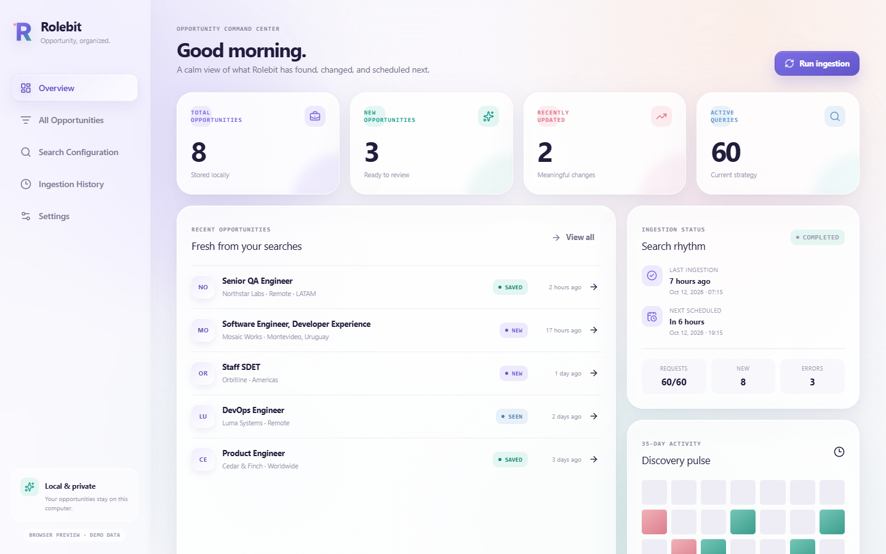

# Rolebit

Rolebit is a local-first Windows desktop application for discovering, collecting, and reviewing job opportunities. You define sites and locations; Rolebit generates the full Cartesian product of Google queries, discovers candidate URLs through Bright Data SERP, classifies pages with OpenAI Decisions API, matches specific postings against your professional profile, removes duplicates, and preserves the resulting library in local SQLite storage.



## MVP capabilities

- Six-step first-run onboarding with a persisted, non-secret local draft.
- Editable Sites, Locations, and optional Roles lists with deterministic query previews.
- Request-volume, monthly-usage, and user-configured cost estimates.
- Bright Data SERP integration with localization, pagination, timeouts, retries, rate-limit handling, and cancellation.
- Direct published-job ingestion from saved Ashby, Greenhouse, Lever, and Workable boards.
- A zero-cost mock provider for development and product evaluation.
- JSON-LD `JobPosting` extraction plus generic HTML page-evidence extraction.
- Decisions API page classification for specific postings, careers pages, contact pages, company pages, and other results.
- Profile fit scores for skills, experience, seniority, and location, shown on the dashboard and opportunity details.
- Canonical URL normalization, source-ID identity, content hashes, transactional upserts, revisions, and multi-query discovery attribution.
- SQLite FTS5 search, database-backed filters, deterministic sorting, and 25/50/100-row pagination.
- Opportunity details, original-posting links, and independent New, Seen, Saved, and Dismissed tracking states.
- Overview metrics, live ingestion progress, execution history, query-level errors, and real activity data.
- Local scheduling, startup execution, overlap prevention, one-run catch-up behavior, cancellation, recovery, and system-tray controls.
- Windows Credential Manager storage for Bright Data and OpenAI API keys.
- NSIS installer configuration and tagged GitHub Release automation.

## Technology

Rolebit uses Tauri 2, Rust, React, TypeScript, Vite, Tailwind CSS 4, Radix/shadcn-style accessible primitives, Lucide icons, and bundled SQLite through `rusqlite`. The application has no hosted backend, local HTTP service, Docker dependency, or centralized account.

## Local-first architecture

```text
React UI
  │ typed Tauri commands and progress events
  ▼
Rust application core
  ├─ query generation
  ├─ Bright Data / mock search provider
  ├─ public ATS job-board APIs for saved boards
  ├─ guarded page fetch and extraction
  ├─ normalization and transactional deduplication
  ├─ scheduler and system tray
  └─ repositories and migrations
       ▼
     SQLite + FTS5                 Windows Credential Manager
     opportunities, history,      Bright Data and OpenAI API keys
     configuration, attribution
```

Persistent records live in the operating system application-data directory, not the installation folder. On Windows the database is normally located at `%APPDATA%\com.rolebit.desktop\rolebit.sqlite3`. Stored opportunities remain available without a network connection and survive application upgrades.

See [architecture.md](docs/architecture.md) for module and schema details and [design-system.md](docs/design-system.md) for the visual source of truth.

## Development prerequisites

- Windows 10 or 11 for the supported desktop target.
- Node.js 22 or newer.
- Rust stable with the MSVC target.
- Microsoft C++ Build Tools and Windows SDK required by Tauri.
- Microsoft Edge WebView2 Runtime. Windows 11 includes it; the NSIS installer uses Tauri's silent download bootstrapper when it is missing.

Install dependencies and start the desktop application:

```powershell
npm ci
npm run tauri dev
```

For a browser-only visual preview with local in-memory demonstration data:

```powershell
npm run dev
```

Browser preview data is clearly labeled and never enters a production user's SQLite database. Add `?onboarding=1` to preview the first-run experience.

## Bright Data configuration

1. Open Settings or the first-run wizard.
2. Choose **Bright Data SERP**.
3. Enter the API key and SERP zone identifier.
4. Set Google's two-letter `gl` country code and `hl` language independently from the Locations search list. The default country is Uruguay (`uy`).
5. Optionally choose **Test connection**. The interface warns that this explicit test may consume one paid request.

The key is stored through Windows Credential Manager and is never written to SQLite, frontend storage, source control, logs, or diagnostics. Rolebit never runs a paid search simply because the application started or settings were saved. A live request occurs only after an explicit test, manual ingestion, or a schedule the user enabled.

The initial integration calls `POST https://api.brightdata.com/request` with an encoded Google Search URL and `brd_json=1`. The adapter defensively accepts current structured-response shapes and records empty results separately from request failures.

Each live Bright Data ingestion also reads previously saved employer boards and fetches their published postings from the corresponding public ATS API. Ashby, Greenhouse, Lever, and Workable responses are normalized into the same opportunity records, matched against the profile, deduplicated, and attributed to their ATS provider. Lever feeds are paginated and support both global and EU endpoints. Boards first discovered during a run are included in the next run. Mock ingestions stay local and do not call ATS APIs.

## Decisions API and profile matching

Configure the OpenAI key in **Settings → Decisions API**. Bright Data search results require this key: fetched pages are classified, and a page classified as one specific posting is sent in a second request for profile matching when professional profile details are available. ATS API responses already represent individual published postings, so they skip page classification and go directly to profile matching. Unchanged known postings reuse their saved decisions. The mock provider stays local and makes no OpenAI requests. Settings and manual connection tests warn that Decisions API requests may incur charges; saving settings does not start a run.

Classification uses the page title, extracted company or board, source domain, and up to 20,000 characters of page text. Matching runs only after a page is classified as one specific opening. It sends job-relevant professional details such as skills, work history, education, projects, languages, location, and work eligibility. Names, preferred names, contact details, street address, profile links, project URLs, and credential URLs are excluded. Each opportunity stores an overall fit score, confidence, and skill, experience, seniority, and location scores.

Saved opportunities are analyzed when first discovered. Later ingestions reuse the classification and match for unchanged postings; changed page evidence triggers reclassification and, if the page remains a posting, matching again. Changed professional profile data triggers matching only. The dashboard highlights strong matches at 75% or higher; opportunity details show the full score breakdown and any scoring error.

## Query generation and cost awareness

For every enabled site and location, Rolebit generates a query. When **Include roles in queries** is enabled, each enabled role is added as a quoted search term and produces its own query combination:

```text
site:<site> "<location>"
site:<site> "<location>" "<role>"
```

The order is deterministic. Schemes and path suffixes are removed from site inputs, quoted terms are escaped, equivalent generated queries are deduplicated, and intentionally empty location values remain supported. Role terms are excluded by default, preserving the previous query behavior until enabled. Rolebit does not rewrite or optimize a strategy automatically.

The preview shows exact queries, pages per query, planned search requests, recurring monthly search usage, and estimated Bright Data cost using the user's own per-request estimate. Decisions API requests are additional and are billed by OpenAI. An optional request budget blocks an execution before any provider call if the search plan is too large.

## Ingestion, extraction, and safety

The live ingestion uses two paths:

```text
Search configuration → Queries → Bright Data SERP → Candidate URLs → Fetch → Extract → Decisions API classification ─┐
Saved ATS boards → Public ATS APIs → Normalize published postings ──────────────────────────────────────────────────┴→ Profile match → Upsert → Dashboard
```

Candidate fetches allow HTTP/HTTPS only. Direct and DNS-resolved loopback, private, link-local, and local destinations are rejected. Redirects are followed manually and revalidated before each request. Rolebit does not bypass authentication, CAPTCHAs, or access controls and never executes downloaded scripts.

Extraction prefers structured `JobPosting` JSON-LD and otherwise gathers page evidence from HTML. Results are no longer rejected by a local host/path check before extraction, including when a page redirects to a canonical URL outside the searched ATS pattern. The Decisions API classifies each fetched page instead of local title, path, or content heuristics rejecting generic results before classification. Careers, contact, company, and other pages are recorded as filtered discoveries; only specific postings become opportunities. Failed or unresolved candidates remain associated with their query execution and are visible in ingestion history; missing fields are not invented.

## Deduplication and attribution

Identity precedence is a reliable source-specific ID followed by the normalized canonical URL. Rolebit deliberately avoids merging jobs by title/company similarity alone.

- A new posting creates one `jobs` record with tracking state `new`.
- An unchanged repeat updates `last_seen_at` and preserves the user's tracking state.
- A meaningful change updates verified fields, preserves stronger existing values, records a revision, and surfaces an Updated indicator.
- A reliably rediscovered closed posting can become active and records a Reopened indicator.
- Concurrent discoveries use an immediate SQLite transaction and uniqueness constraints, preventing duplicate canonical jobs.

Every discovery remains a separate record linked to its run, query execution, provider, and discovered URL. One job can therefore show several source queries without duplicating its full description.

## Scheduling and background behavior

Scheduling defaults to 12 hours and is disabled until the user enables it. The scheduler runs only while the Rolebit process is active. Closing the main window can keep Rolebit in the system tray, with actions to open the app, run ingestion, pause/resume scheduling, or quit.

Rolebit prevents overlapping runs. After shutdown, sleep, or an interrupted execution it records recovery state and allows at most one due execution instead of building a backlog. Optional startup execution and Start with Windows are configured independently.

## Testing and validation

```powershell
npm run lint
npm test
npm run build
cargo fmt --manifest-path src-tauri/Cargo.toml -- --check
cargo test --manifest-path src-tauri/Cargo.toml --lib
```

No automated test makes a paid Bright Data request. Rust tests cover Cartesian query generation, response parsing, JSON-LD and page-evidence extraction, migrations, FTS filtering, pagination behavior, revisions, tracking-state preservation, multi-query attribution, and concurrent deduplication. Frontend tests cover configuration editing, query previews, filters, status changes, and application-shell rendering.

Rendered screenshot QA is available through `npm run visual:qa` while `npm run dev` is active. The checked-in captures cover onboarding, overview, opportunities, details, configuration, history, and settings at 1440×900.

## Windows builds and installation

Build an unsigned NSIS installer:

```powershell
npm run tauri build -- --bundles nsis
```

The installer is emitted beneath `src-tauri\target\release\bundle\nsis`. It installs per user, creates Start Menu/uninstall entries, and obtains WebView2 when necessary. User data is outside the install directory and is not silently removed during application uninstall.

Unsigned local builds can trigger a Microsoft Defender SmartScreen warning. Production releases should be Authenticode-signed by configuring a certificate thumbprint, SHA-256 digest, and RFC 3161 timestamp server in Tauri's Windows bundle settings or by supplying an approved signing command. Never commit signing certificates or passwords.

The CI workflow checks frontend and Rust code and performs a Windows desktop build. Pushing a `v*` tag runs the release workflow, builds the NSIS artifact, and publishes it through GitHub Releases. Compiled installers are intentionally excluded from source control.

## Known limitations

- The Bright Data path is covered by mocked responses but has not been live-tested with paid credentials in this repository.
- Decisions API matching runs during ingestion; saved postings are refreshed when searches rediscover them.
- Scheduling cannot run while Rolebit is quit or the computer is powered off.
- Installers are unsigned until the repository owner configures a trusted code-signing identity.
- The MVP prioritizes the refined light theme; a dark theme is not included.
- Application-stage tracking, resume generation, and automated applications are outside this MVP.
